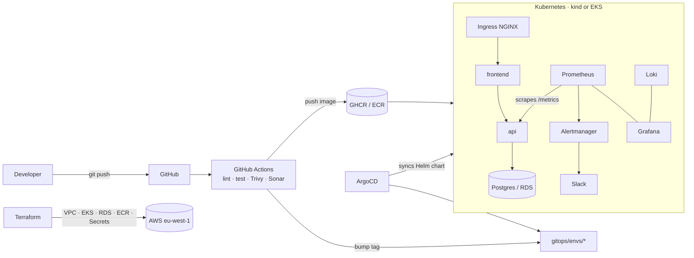

# devops-e2e

End-to-end DevOps platform for a small todo app: containers → Kubernetes → CI with security scanning → Terraform on AWS → GitOps with ArgoCD → metrics, logs and alerts.


## Architecture



## Repo layout

| Path | What |
|---|---|
| `app/api` | FastAPI service: CRUD todos, `/health`, `/ready`, `/metrics` |
| `app/frontend` | Static UI on unprivileged NGINX, proxies `/api` |
| `docker-compose.yml` | Full stack locally |
| `charts/devops-e2e` | Helm chart: Deployments, HPA, PDB, Ingress, NetworkPolicies, ServiceMonitor, alerts, ExternalSecret |
| `gitops/` | Per-env values + ArgoCD app-of-apps |
| `infra/` | Terraform: VPC, EKS (spot), RDS, ECR, Secrets Manager, IRSA |
| `monitoring/` | kube-prometheus-stack values, Grafana dashboard |
| `.github/workflows` | CI (app) and Terraform (infra) pipelines |

## Quick start

**1. Docker Compose** (no Kubernetes)
```bash
make test
make compose-up      # http://localhost:8080
```

**2. Local Kubernetes** (needs kind, kubectl, helm)
```bash
make kind-up
make monitoring      # optional: Prometheus, Grafana, Loki
make deploy          # http://todo.localtest.me
make port-grafana    # http://localhost:3000  admin/admin
```

**3. GitOps**
1. Push this repo to `github.com/kirthikesh/devops-e2e`.
2. Make the two GHCR packages public (or add an imagePullSecret).
3. `make argocd` – ArgoCD now deploys every commit to `main`.

Flow: push to `app/**` → CI tests, scans and pushes `:<sha>` → CI commits the tag to `gitops/envs/dev/values.yaml` → ArgoCD syncs.

**4. AWS** (costs money; destroy after each session)
```bash
cd infra/bootstrap && terraform init && terraform apply -var="state_bucket=<unique-name>"
# set that bucket name in infra/versions.tf
make tf-apply
$(terraform -chdir=infra output -raw kubeconfig_command)
helm repo add external-secrets https://charts.external-secrets.io
helm install external-secrets external-secrets/external-secrets -n external-secrets --create-namespace \
  --set serviceAccount.annotations."eks\.amazonaws\.com/role-arn"=$(terraform -chdir=infra output -raw external_secrets_role_arn)
kubectl apply -f k8s/cluster-secret-store.yaml
# then: ingress-nginx, `make monitoring`, `make argocd`, rename gitops/argocd/apps/todo-prod.yaml.disabled
make tf-destroy
```

## What this demonstrates

- **Containers:** multi-stage builds, non-root users, healthchecks
- **Kubernetes:** probes, resource limits, HPA, PDBs, default-deny NetworkPolicies, rolling updates with zero unavailable
- **CI:** lint, unit tests, Helm lint, Trivy with SARIF to GitHub Security, optional SonarCloud, layer caching
- **GitOps:** CI never touches the cluster; ArgoCD reconciles from git with self-heal and prune
- **IaC:** remote state with locking, community modules, spot nodes, OIDC to AWS (no static keys), Checkov
- **Secrets:** RDS password generated by Terraform, stored in Secrets Manager, synced by External Secrets via IRSA
- **Observability:** golden-signals dashboard, PromQL alerts for error rate, p95 latency and crash loops, logs in Loki

## Ideas to extend

- Canary releases with Argo Rollouts
- cert-manager + Let's Encrypt for TLS
- Kyverno policies (block `:latest`, require limits)
- k6 load test in CI to trigger the HPA
- Infracost comment on Terraform PRs
