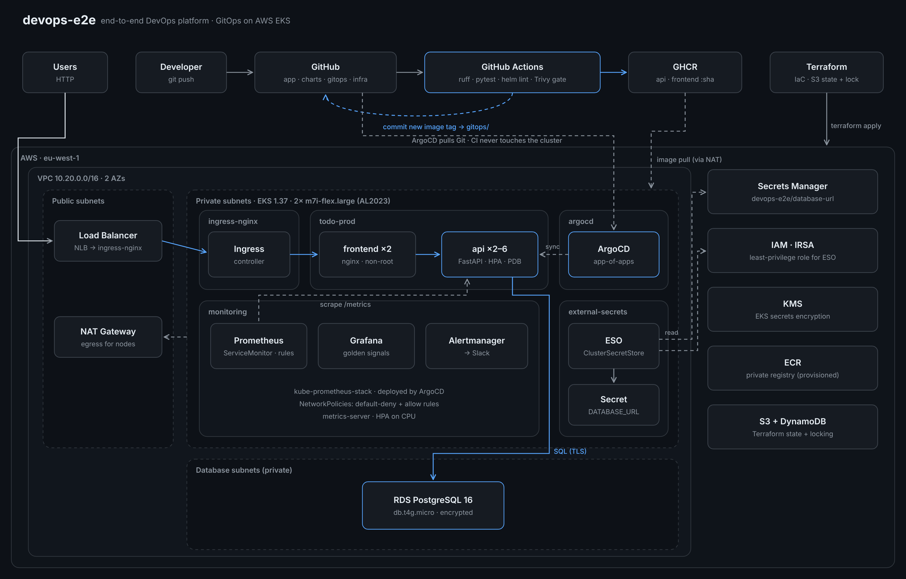
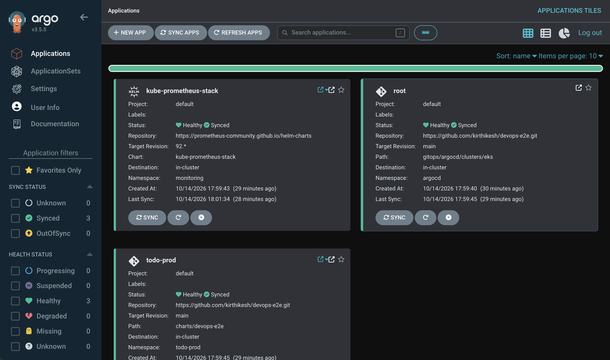
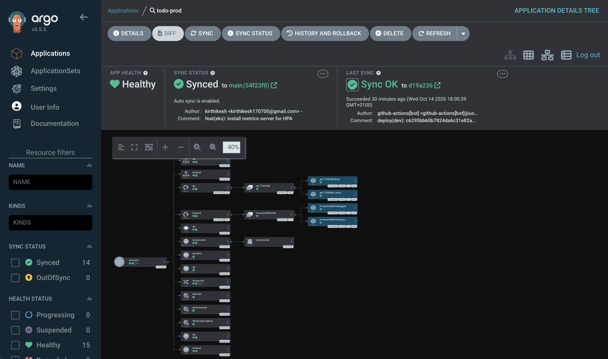
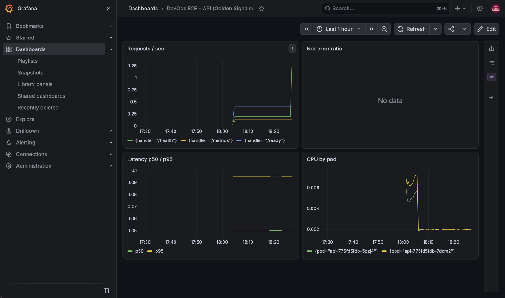
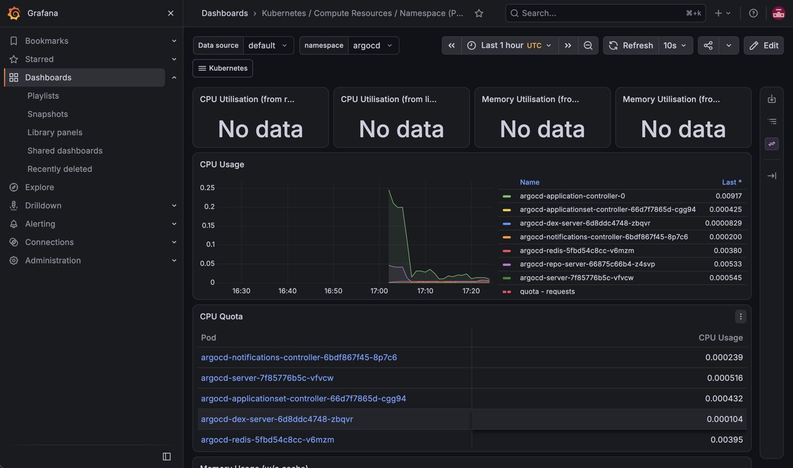
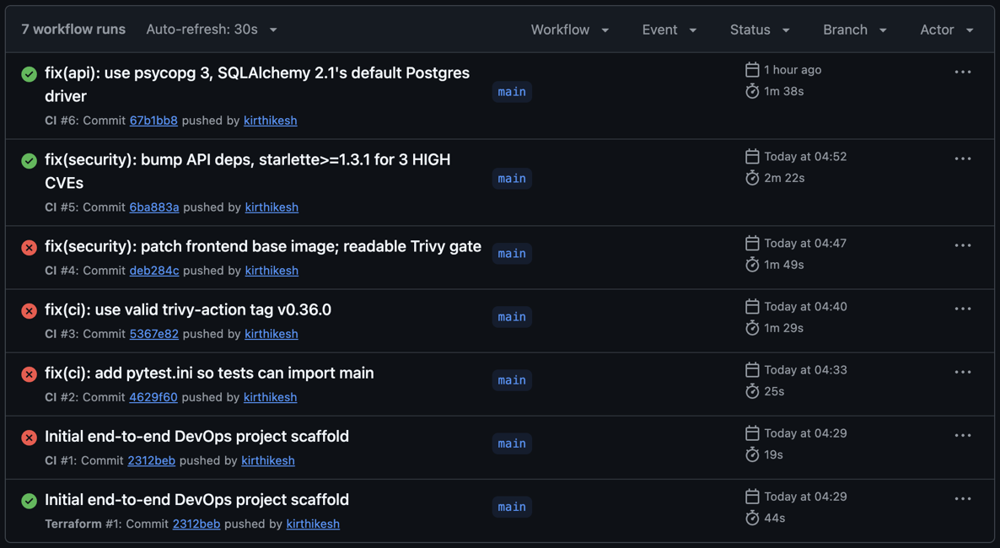
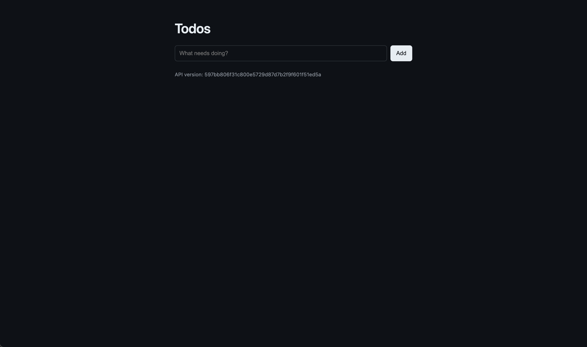
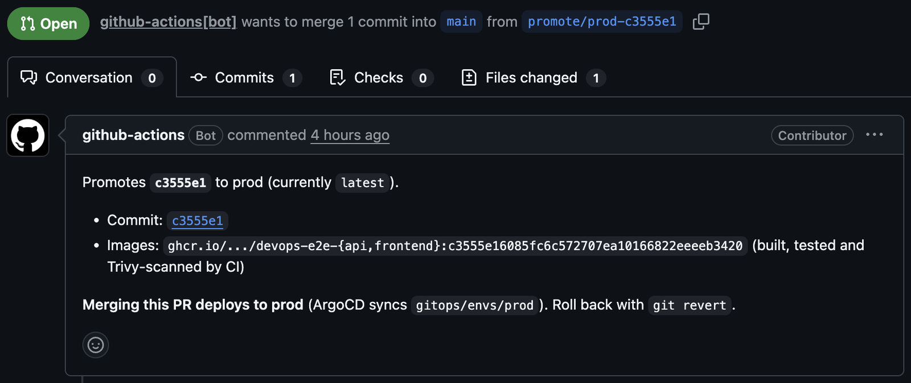
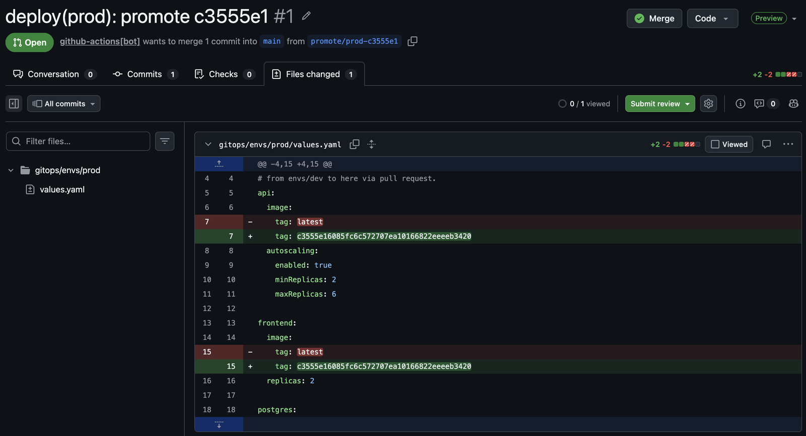

# devops-e2e

A small todo app shipped the way production teams ship software: containerised, tested and scanned in CI, deployed to **AWS EKS** with **GitOps**, provisioned with **Terraform**, and observed with **Prometheus and Grafana**.




## How a change reaches production

1. **Push** to `main`.
2. **CI** (GitHub Actions) runs `ruff`, `pytest` and `helm lint`, builds both images, and scans them with **Trivy**. Any HIGH or CRITICAL vulnerability with a fix available **blocks the release**.
3. CI pushes `api` and `frontend` images to GHCR, tagged with the **commit SHA**.
4. CI commits that tag to `gitops/envs/dev/values.yaml`. **CI never talks to the cluster** and holds no cluster credentials.
5. **ArgoCD** notices the Git change and rolls it out. Readiness probes gate the rollout, and a manual change in the cluster is reverted (self-heal).

6. **Prod is promoted on purpose.** Running the *Promote to prod* workflow checks that the images exist, then opens a
   pull request that pins prod to that exact commit SHA. **Merging the PR is the prod deploy.**

Rollback is `git revert`. Every deploy, dev or prod, is a commit.

## Screenshots

| ArgoCD on EKS: all apps synced and healthy | Prod app: every resource ArgoCD manages |
|---|---|
|  |  |
| **Grafana: API golden signals (traffic, latency, CPU)** | **Grafana: per-pod CPU on EKS** |
|  |  |
| **CI history: red until the Trivy gate's CVEs were fixed** | **The app** (footer shows the deployed commit SHA) |
|  |  |
| **Prod promotion: the PR the workflow opens** | **Prod promotion: the whole deploy is a 2-line diff** |
|  |  |

## Stack

| Area | Tools |
|---|---|
| App | FastAPI, SQLAlchemy 2.1, psycopg 3, NGINX (unprivileged), PostgreSQL |
| Containers | Multi-stage Dockerfiles, non-root users, healthchecks |
| CI | GitHub Actions, ruff, pytest, Helm lint, **Trivy** (SARIF to GitHub Security + blocking gate) |
| CD | **ArgoCD** app-of-apps, automated sync, prune, self-heal |
| Kubernetes | Helm, HPA, PodDisruptionBudgets, default-deny NetworkPolicies, probes, resource limits |
| Infrastructure | **Terraform**: VPC (public / private / database subnets), **EKS 1.37**, RDS PostgreSQL 16, ECR, KMS, Secrets Manager, IAM |
| Secrets | **External Secrets Operator** reading AWS Secrets Manager through **IRSA**: no static credentials anywhere |
| Observability | kube-prometheus-stack (Prometheus, Grafana, Alertmanager), ServiceMonitor, PromQL alert rules, metrics-server |
| Local | Docker Compose, kind |

## Repo layout

| Path | What |
|---|---|
| `app/api` | FastAPI service: CRUD, `/health`, `/ready`, Prometheus `/metrics` |
| `app/frontend` | Static UI on unprivileged NGINX, proxies `/api` |
| `charts/devops-e2e` | Helm chart: Deployments, HPA, PDB, Ingress, NetworkPolicies, ServiceMonitor, PrometheusRule, ExternalSecret |
| `gitops/envs/{dev,prod}` | Per-environment values. CI writes the dev image tag here |
| `gitops/argocd/apps` | App-of-apps for the **local kind** cluster (dev app, in-cluster Postgres) |
| `gitops/argocd/clusters/eks` | App-of-apps for **EKS** (prod app on RDS, monitoring) |
| `infra/` | Terraform for AWS. `infra/bootstrap` creates the S3 state bucket and lock table |
| `monitoring/` | kube-prometheus-stack values, Grafana dashboard ConfigMap |
| `.github/workflows` | `ci.yml` (app), `promote.yml` (prod promotion PR), `terraform.yml` (fmt, validate, Checkov, plan via OIDC) |

## Run it

### Locally with Docker Compose
```bash
make test          # ruff + pytest
make compose-up    # http://localhost:8080
```

### Locally on Kubernetes (kind + ArgoCD)
```bash
make kind-up       # 2-node kind cluster + ingress-nginx
make argocd        # ArgoCD, then everything else syncs from Git
```
Add `127.0.0.1 todo.localtest.me argocd.localtest.me` to `/etc/hosts`, then open http://todo.localtest.me.

### On AWS EKS
> **Costs money while running** (EKS control plane, 2 nodes, NAT gateway, RDS, load balancer). Always finish with `make eks-down`.

```bash
# one-time: remote state
cd infra/bootstrap && terraform init
terraform apply -var="state_bucket=devops-e2e-tfstate-<account-id>"
echo 'bucket = "devops-e2e-tfstate-<account-id>"' > ../backend.hcl   # git-ignored
cd ../..

make tf-apply      # VPC, EKS, RDS, IAM, Secrets Manager (about 20 min)
make eks-up        # ingress (NLB), metrics-server, External Secrets, ArgoCD + EKS app-of-apps
# ... use it ...
make eks-down      # removes the load balancer first, then terraform destroy
```

## Engineering decisions

- **Pull-based GitOps.** CI only writes to Git, so a compromised pipeline can't change the cluster directly, and Git history is the deploy history.
- **Trivy in two steps.** The full report always uploads to the GitHub Security tab, and a separate table-format gate fails the build only on fixable HIGH/CRITICAL issues. You get visibility without blocking on vulnerabilities nobody can fix yet.
- **Secrets never live in Git or CI.** Terraform generates the RDS password and stores it in Secrets Manager. External Secrets syncs it into the cluster using an IAM role bound to one Kubernetes service account (IRSA).
- **Separate app-of-apps per cluster.** Local kind runs the dev app with in-cluster Postgres. EKS runs prod on RDS. The same Helm chart serves both, with different values.
- **Disposable infrastructure.** Nothing on AWS is precious: `terraform apply` rebuilds it in about 20 minutes, so it only runs when it's being used.
- **Right-sized monitoring.** Control-plane scrapes and rules that kind and EKS don't expose are disabled, so the alerts stay meaningful and there's no noise.

## Problems I hit, and how I fixed them

| Problem | Root cause | Fix |
|---|---|---|
| CI blocked the release | Trivy found **3 HIGH CVEs** in `starlette` (DoS, SSRF) | Upgraded FastAPI and pinned `starlette>=1.3.1`. The gate did its job |
| API pods in `CrashLoopBackOff` after the upgrade | SQLAlchemy 2.1 changed the default Postgres driver to psycopg 3 | Switched drivers and **added a regression test** that imports the DB driver |
| EKS node group stuck in `CREATING` for 20 minutes with no error | **CloudTrail** showed `RunInstances` rejected: the account plan only allows certain instance types | Switched to an eligible `m7i-flex.large`, on-demand, in Terraform |
| ArgoCD wouldn't sync the app | The chart created a `ServiceMonitor` before the Prometheus CRDs existed | Ordered with sync waves and retry, and kept the ServiceMonitor off where monitoring isn't installed |
| `ExternalSecret` rejected | External Secrets 2.x stopped serving the `v1beta1` API | Moved the manifests to `external-secrets.io/v1` |
| Prod app showed `Degraded` with all pods running | The HPA had no metrics source on EKS | Installed metrics-server and added it to `make eks-up` |
| ArgoCD install failed on a fresh cluster | The ApplicationSet CRD is too large for client-side `kubectl apply` | Used `--server-side` apply |
| kind ingress returned connection resets | The ingress controller was scheduled on the worker, but only the control plane maps ports 80/443 | Pinned the controller to the control-plane node |
| `terraform destroy` can hang on the VPC | A load balancer created by Kubernetes still uses the subnets | `make eks-down` deletes the ingress (and its NLB) before destroying |

## Security

- Non-root containers, `allowPrivilegeEscalation: false`, all Linux capabilities dropped, `RuntimeDefault` seccomp
- Default-deny ingress NetworkPolicies with explicit allow rules
- RDS in private database subnets, reachable only from the EKS node security group, encrypted at rest
- No long-lived AWS keys in CI: the Terraform `plan` job is built for GitHub OIDC (enable it by setting the `AWS_ROLE_ARN` repo variable)
- Terraform state encrypted in S3, versioned, public access blocked, with DynamoDB locking
- The `infra/backend.hcl` file holding account details is git-ignored

## Roadmap

- [ ] Canary releases with **Argo Rollouts**, plus automated rollback on error-rate SLOs
- [x] Promote dev to prod through a pull request, pinned to an exact SHA
- [ ] **Loki** for logs alongside metrics in Grafana
- [ ] Move from ingress-nginx (retired upstream) to **Gateway API**
- [ ] cert-manager + Let's Encrypt for TLS
- [ ] Kyverno policies: block `:latest`, require resource limits

---

Built by **Kirthikesh Parthasarathy**, DevOps engineer, Dublin · [GitHub](https://github.com/kirthikesh)
